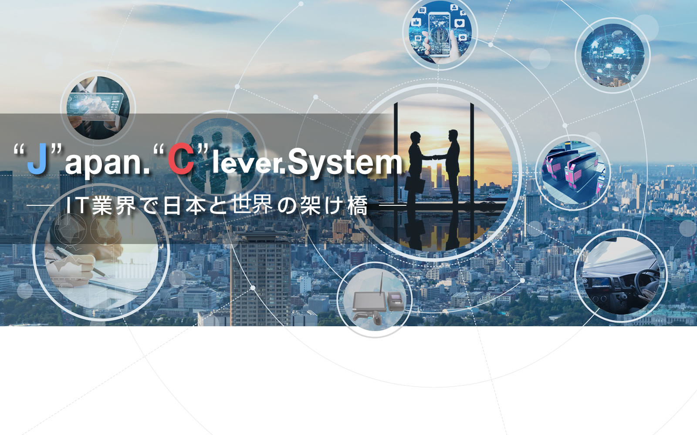
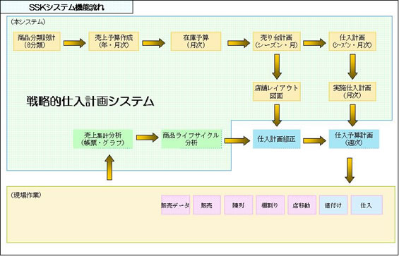

# design

## template

html5up.net/editorial

## layout

## style

## font

# defines

- site-logo:
  
- site-logo-sub:
  
- company-name:
  株式会社 J.C.System
- copyright:
  Copyright © 2026 J.C.System Co.,Ltd. All Rights Reserved.
- address:
  〒542-0081 大阪府大阪市中央区南船場2-7-14 大阪写真会館5F
- tel:
  06-4705-7666
- fax:
  06-4705-7667

# pages

## index(トップ)

### item-1: ABOUT / J.C.Systemについて

- オフショア開発のプロのブリッジSE役を果たし、実績を誇っています。
- 世代車載システムの構築等最先端の研究・開発に取り組んでいます。
- クラウド型POSシステム、本部管理システムを提供します。
- 業界のオンリーワンを目指し、自ら実践します。
- 日本と世界とを橋渡しする、IT化戦略のプロバイダーを果たします。

[MORE](#会社案内)

### item-2: SERVICE / 事業紹介

オフショア開発を主軸に様々なシステム開発や
ASPサービス等を行っています。

### item-3: PRODUCTS / 製品紹介

POSレジシステム・衣料小売店データ処理
システム等の製品をご紹介いたします。

[MORE](#製品情報)

### item-4: RECRUIT / 採用情報

日本と世界の橋渡し
ブリッジSE募集中。

[MORE](#採用情報)

## company(会社案内)

### item-1: ご挨拶

　株式会社J.C.Systemは、2002年の会社設立以来、業務系・携帯や自動車などの組込系のソフトウェア開発とオフショア開発向けブリッジSEサービス業務との２本柱を主力事業にしています。 「海外オフショアの成功事例は失敗例よりずっと少ない、意思疎通の困難さ、設計変更による予想外の費用増加等でもうオフショアが成り立たない、海外開発は苦労した結果、結局コストが高くなる…」など昨今、オフショア開発に対して、難しい声がますます高まっています。当社のブリッジSE事業は、来日10年以上で、上流設計とマネジメントの経験豊富な中国人SEをコアメンバーで構成されております。

　フューチャーフォン時代の大規模携帯開発を初め、現在車載、カーナビ―システムの開発を中心にさまざまな規模のオフショア開発に参画しています。日本客様+当社プロブリッジSE+オフショアチームという体制で、数多くの成功実績を持っています。 社会変化のスピードが速まり、時代の潮目が大きく変わろうとする現在、「競争」より「協創」つまり、単純のオフショアからリソースの共有、技術の分業協力に変わるつつあります。 また当社は小人数精鋭制ですが、流通と車載システムをコア技術に、海外の豊富なリソースを活用して、プロダクト事業やアウトソーシング事業、グローバル展開など、常に新しい技術トレンドを取り入れ、時代の要請に応えてまいりました。

#### sub-item-1: 署名

代表取締役： 張 長奎

### item-2: 会社概要

- 会社名：株式会社 J.C.System
- 設立年月日：2002年4月17日
- 資本金：1,000万円
- 従業員数：
- 代表者名：張　長奎
- 代表者写真：
- 事業内容：
  - ソフトウェア開発事業
    - 業務システム：流通業・不動産業・金融業等システム企画、設計、開発
    - 組込システム：携帯本体システム・車載システム・カーナビシステムの開発
  - フリッジSE業務
    ブリッジSE業務の請負・人材派遣・海外プロジェクト管理
  - ソフトプロバイダー事業
    不動産業・小売業システムサービスの提供
- 所在地：
  - 大阪本社
    〒542-0081 大阪府大阪市中央区南船場2-7-14 大阪写真会館5F
    TEL:06-4705-7666 FAX:06-4705-7667
  - 東京事務所
    〒153-0065 東京都目黒区中町1-8-11
    TEL:03-3713-6267 FAX:03-5720-7722
- 取締役：
  - 福本　眞憲
  - 杜　欣然
  - 陳　培文
- 連絡先：
- 決算期：年1回　2月末
- 公式サイトURL：
- 主要取引先：
- 企業理念：
- ビジョン：
- ミッション：
- 価値観：
- 組織図：
- 主要メンバー紹介：
- 受賞歴：
- 取引銀行：
  - 関西アーバン銀行　茨田支店
  - 近畿大阪銀行　南支店
- 主要株主：
- 事業所一覧：
- 関連事務所
  大阪、東京、北京、大連

### item-3: 沿革：

- 2002年4月
  有限会社ジェイシーシステム設立
- 2006年5月
  資本金１０００万円へ増資　株式会社J.C.Systemへ変更
- 2007年11月
  特定労働者派遣事業開始
- 2008年10月
  本社を東京都港区に移転
- 2012年7月
  傑西泰利（北京）科技有限公司を設立
- 2013年11月
  本社を大阪中央区に移転
- 2014年6月
  関連会社 JC貿易株式会社を設立、貿易業務を開始

### item-4: グループ会社

- JC貿易株式会社
- 傑西泰利（北京）科技有限公司
- 多思科技（大連）有限公司

### item-5: 業務実績

- 2002年～2005年 各種業務システムの請負開発：
  - クリーニングチェーンシステム
  - 株情報受信システム
  - 宝石卸業ERPシステム
  - 革製品卸業ERPシステム
  - 不動産賃貸管理総合システム
- 2002年～2005年
  小商圏対応型衣料品店の戦略的在庫管理システム
  （2002年～2003年度近畿経済産業局「中小商業ビジネス支援事業」）
- 2006年～2013年
  京セラ携帯端末、CASIO携帯端末のシステム開発、ブリッジSE業務
- 2008年～2016年
  カーナビゲーションシステム開発、ブリッジSE業務
- 2016年～2024年現在
  車載システムのプラットフォーム開発
  カーナビゲーションシステム開発

### item-6: アクセス

- 大阪本社
  大阪メトロ　堺筋線・長堀鶴見緑地線　長堀橋駅　1番出口より徒歩3分

## services(サービス/事業内容)

### item-1： 海外オフショア開発におけるブリッジSE業務

**弊社のブリッジSE業務の特徴とは**

- 日本語、中国語または現地語できるSE（コミュニケーション）
- 技術フォロー、成果物レビューできる（テクノロジー）
- 進捗管理、リスクマネジメントなどのPMA業務（マネジメント）

すべてできる人がブリッジSEとして提案しています。
日本側のお客様は現地語不要です。受注側も日本語ができなくても大丈夫です。

### item-2： 組み込みソフトウェアの開発・ソリューション

- モバイル端末開発
- 車載アプリケーションの開発
- デジタルテレビ、デジタルAV製品の開発
- JR窓口精算システム、地下鉄券売システムの開発等

### item-3： ASPサービス

- 総合衣料小売業のデータ分析・経営戦略支援オンラインサービス
- 不動産賃貸管理・契約業務オンラインサービス

## products(製品情報)

### item-1： 小商圏対応型衣料品店の戦略的仕入計画システム

衣料品小売業向けの戦略的な仕入計画の観点から、全体の仕入れ販売業務における主導的な計画の作成を支援するシステム

### item-2： JC-Tintai-不動産賃貸業務向けオンラインサービスシステム

JC-Tintaiは物件情報をデータベース化で管理して、物件登録、空き物件検索、部屋情報管理、契約書類作成、契約管理、更新案内情報管理など賃貸業務関連の処理をすべてプラウザで実現し、業務全体の効率化を実現したパッケージです。現地でのソフト導入、インストールが不要で、すべてクラウドサーバで実現しています。初期費用不要で、毎月の使用料で簡単にシステムを導入できます。

### item-3： JCooPOS-小売チェーン店舗向け完全Web仕様PC POSシステム

クラウド型WEB POSシステム「PCooPOS」はブラウザで動くWEB POSシステムです。ブラウザがあれば、時間･場所を気にせず手軽に使用可能です。リアルタイムに店舗の売上を把握したり、ポイントシステムを導入して全店舗でポイントをリアルタイムで共有することができます。PC、Tablet、携帯画面に対応できます。 いつでも、どこでも、何でもPOSというシステムが実現しています。 初期費用が安くて、店舗毎、月次使用料で契約でき、簡単にシステムを導入できます。

### item-4： JChonbuファーションズ-繊維小売業向け戦略的本部システム

クラウド型衣料小売向けの本部システムです。商品発注、仕入、支払、在庫、顧客、入金、ポイント管理など一連の業務を実現しています。また、衣料小売向けの戦略的な分析帳票、仕入アクションリスト機能があります。業務の効率化の他、データ分析から今まで以上に戦略的な仕入計画、最適化の店間移動、値変処理を提案してくれるシステムです。 クラウド型で、自社サーバーが不要で、ハードウェアのコストを最小限に抑えられます。画期的な小売り業者のERPシステムです。

## careers(採用情報)

### item-1： 募集要項

#### sub-item-1：　システムエンジニア・組込み系開発ブリッジSE（中途採用）

| 勤務地       | 大阪府、関西地区（神戸、京都）愛知県（名古屋市周辺）、東京都                                                                                                                                     |
| ------------ | ------------------------------------------------------------------------------------------------------------------------------------------------------------------------------------------------ |
| 給　与       | 【年俸制】600万円～1000万円                                                                                                                                                                      |
| 日本語力     | ビジネスレベル、 クライアントの担当者との打ち合わせ                                                                                                                                              |
| 仕事内容     | ソフトウェアの要件定義・基本設計オフショア開発の管理、オンサイト開発、品質管理                                                                                                                   |
| 雇用形態     | 正社員・契約社員（正社員登用制度あり）                                                                                                                                                           |
| 求める人物像 | 論理的なコミュニケーション能力がある 協調性に優れ、前向きに物事に取り組める 高いチームワーク意識、リーダーシップ                                                                           |
| 応募条件     | 組込み系開発経験者優先 プロジェクトマネジメント / リーダ経験のある方大歓迎 車載機器（カーナビ、カーオーディオ）、デジタル家電、携帯端末などの組込みシステムにおける開発経験が3年程度ある方 |
| 勤務時間     | 9:00～17:45                                                                                                                                                                                      |
| 休日・休暇   | 完全週休２日制（土曜・日曜）年末年始休暇､ゴールデンウィーク、夏季休暇、有給休暇、特別休暇                                                                                                        |
| 昇格・昇給   | 年１回　（当社人事考課制度による成績評価）                                                                                                                                                       |
| 福利厚生     | 健康保険・厚生年金保険・雇用保険・労災保険完備  その外 社内慰安旅行、定期的リクリェーション開催など                                                                                        |

#### sub-item-2：　システムエンジニア・組込み系開発ブリッジSE（中途採用）

| 勤務地       | 大阪府、東京都                                                                                        |
| ------------ | ----------------------------------------------------------------------------------------------------- |
| 募集対象     | ４年制大学もしくは大学院を卒業の方                                                                    |
| スキル・経験 | 理系                                                                                                  |
| 給　与       | 【月給】 大卒　　　230,000円～ 大学院卒　250,000円～                                            |
| 勤務時間     | 9:00～17:45                                                                                           |
| 休日・休暇   | 完全週休２日制（土曜・日曜） 年末年始休暇､ゴールデンウィーク、夏季休暇、有給休暇、特別休暇         |
| 昇格・昇給   | 年１回　（当社人事考課制度による成績評価）                                                            |
| 福利厚生     | 健康保険・厚生年金保険・雇用保険・労災保険完備 その外 社内慰安旅行、定期的リクリェーション開催など |

### item-2： 応募フォーム

お問い合わせは下記のフォームから送信下さい。後日ご連絡いたします。

回答には2～3営業日のお時間をいただく場合がございます。

お急ぎの方は、お電話にてお願いいたします。お気軽に、お問い合わせ下さい。

06-4705-7666

### item-3： プライバシーポリシー

当サイトは、お客様の個人情報について、お客様の承諾が無い限り第三者に開示、提供を一切いたしません。お客様から個人情報をご提供していただき、お客様へのサービスにご利用させていただく場合があります。その目的以外には利用いたしません。そして、ご提供いただいた個人情報を取り扱うにあたり管理責任者を置き、適切な管理を行っております。

## contact(お問い合わせ)

- 電話番号： 06-4705-7666
- メールアドレス： info@jc-system.co.jp
- 住所： 〒542-0081 大阪府大阪市中央区南船場2-7-14 大阪写真会館5F
- 公式サイトURL： https://www.jc-system.co.jp
- SNSアカウント： -
- 問い合わせフォーム： -

### item-1: 説明

お問い合わせは下記のフォームから送信下さい。後日ご連絡いたします。

回答には2～3営業日のお時間をいただく場合がございます。

お急ぎの方は、お電話にてお願いいたします。お気軽に、お問い合わせ下さい。
